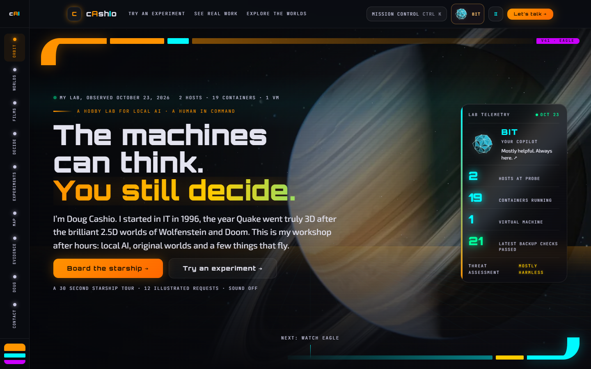
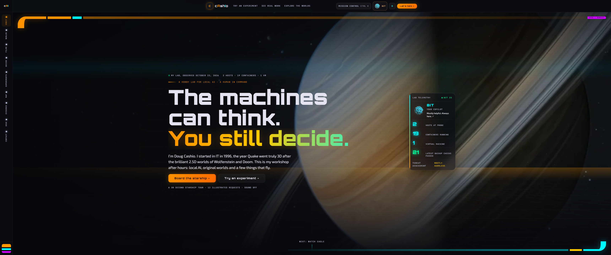
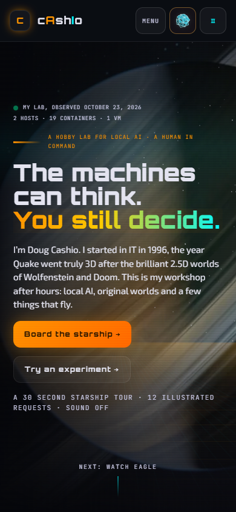
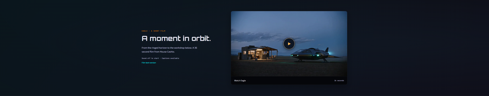
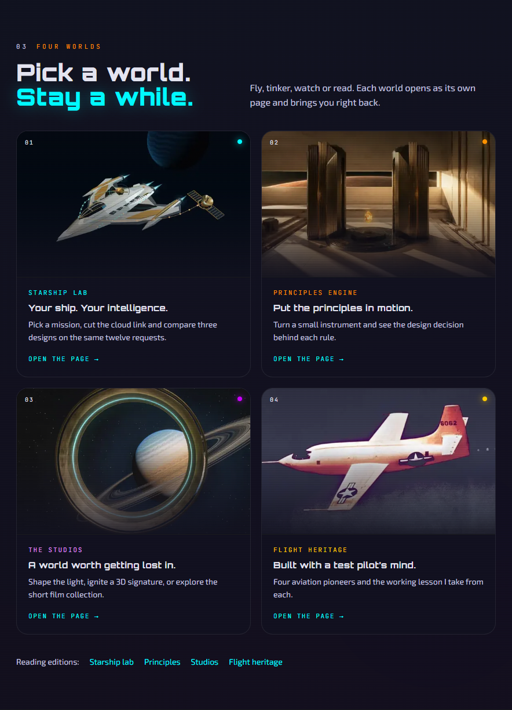

# V41 Eagle · Planet hero and optional film

The planet stays behind the opening headline and Board the starship invitation. Eagle sits below the hero and telemetry ticker, before the workshop. The hero's Next: watch Eagle link leads directly to the film card headed A moment in orbit. Selecting the ship poster labeled Watch Eagle opens the 36 second cinema. Waiting, reloading and scrolling do not download Eagle video.

The original V40 identity remains: Orbitron, Exo 2, JetBrains Mono, the LCARS rail, Bit, E.V.E., Mission Control, seven experiments and the existing ship tour. Twelve section components own the page. External styles, the native pointer, strict CSP and a single playback owner remain in place. The cinema opens muted with native controls, captions, a text version and AV1 followed by H.264. Desktop, phone and data saving renditions are unchanged. Existing `#film=intro` bookmarks still work.

The film invitation now has a prominent gold play control, a gentle image zoom, and matching hover and keyboard feedback. The four world cards form a balanced two by two grid at medium widths, with brighter Studios text and a gentler tilt. The original planet artwork stays intact.

Starfield movement uses elapsed time so its speed does not depend on monitor refresh rate. Ambient drawing is limited to about 30 frames per second, with a faster cadence during the existing warp effect. Its backing canvas is bounded near six million pixels. It stops when hidden, paused, behind the cinema or scrolled behind the fixed header. New hover motion ships in the deferred stylesheet.

## Transfer evidence

Cold Chrome 155 with cache disabled and compressed local transport. First view is sampled two seconds after load. Full scroll advances by 80 percent of viewport height every 180 ms and settles for 1.5 seconds. Values are bytes, including transport overhead. The source baseline and current layout use the same procedure. The new measurements describe this controlled pass, not all browsing behavior.

| Viewport  | Before first view without video | Current first view without video | Before first view total | Current first view total | Before full scroll | Current full scroll |
| --------- | ------------------------------: | -------------------------------: | ----------------------: | -----------------------: | -----------------: | ------------------: |
| 1440×900  |                       1,002,027 |                          606,955 |              10,157,116 |                  606,955 |         17,330,034 |           5,604,096 |
| 3440×1440 |                       1,002,027 |                          606,955 |              10,157,116 |                  606,955 |         17,330,034 |           5,600,661 |
| 390×844   |                       1,002,027 |                          593,370 |               7,994,428 |                  593,370 |         13,128,907 |           5,630,609 |

All three first views meet the 3 MB desktop and 1.5 MB phone budgets. No Eagle video is requested during any measured scroll. All passes have zero page errors and no horizontal overflow. Other visible ambient films retain the shared playback policy. The largest unchanged 1080p rendition is 3,274,766 bytes, and the largest 720p rendition is 1,410,984 bytes. All twelve renditions passed full decode validation in the original media pass.

## Lighthouse and accessibility

Three fresh Lighthouse 13.5 runs per viewport on the current built output. Desktop uses a 40 ms simulated round trip, 10 Mbps and CPU multiplier 1. Phone uses mobile simulated throttling and CPU multiplier 4. These are lab results, not field Core Web Vitals.

| Width | Performance runs | Median | Median LCP | Median blocking time | Accessibility | Best practices |
| ----- | ---------------- | -----: | ---------: | -------------------: | ------------: | -------------: |
| 1440  | 100, 100, 100    |    100 |     0.64 s |               3.5 ms |           100 |            100 |
| 3440  | 100, 99, 99      |     99 |     0.77 s |               4.0 ms |           100 |            100 |
| 390   | 90, 79, 82       |     82 |     3.89 s |             184.5 ms |           100 |            100 |

The mobile median is 82, with a 3.89 second largest contentful paint and 184.5 ms blocking time under simulated throttling. Mobile loading remains an improvement area. The performance self assessment weighs media delivery budgets and explicit playback alongside these lab results.

Preview SEO is 69 because the loopback server sends noindex. Production canonical and index metadata remain intact. The first screen geometry checks use normal local conditions and pass at 1.5 seconds. Axe finds zero serious or critical violations, including matching visible and accessible names, at 1440, 3440 and 390 pixels. The 320 pixel reading edition and phone controls also fit without horizontal overflow. A 3822 by 1600 CSS viewport check approximates the geometry of a 3440 by 1440 display at 90 percent zoom; it is not a physical monitor test.

## Validation

`npm run verify` passed with exit code 0 for this layout: lint, formatting, 294 Node tests, 55 Odyssey tests, build, 24 artifact tests, layout and archive browser checks, 38 current site browser tests, 75 Python release tests, public data guard, consistency and committed whitespace. The Eagle test covers the hero's Next link, no unsolicited video requests, keyboard opening, native controls, captions, both codecs, Escape, visible focus return, direct bookmarks, data saving and reduced motion. The entry stylesheet is 18,205 bytes gzip, within its 19,000 byte budget.

The new starfield regression checks the ambient frame budget, pause and resume, the fixed header visibility boundary, and cinema ownership. A separate responsive pass verifies the film card and one, two or four world columns at 320, 390, 884, 1440 and 3440 pixels with no horizontal overflow or runtime errors. The in app preview also verifies opening Eagle and returning keyboard focus on Escape.

## Nine category scorecard

Engineering self assessment with Doug retaining final visual judgment. The visual criterion follows Doug's approved separation of the planet hero and optional film.

| Category         | Score | Evidence                                                                            |
| ---------------- | ----: | ----------------------------------------------------------------------------------- |
| Brand            |   9.5 | Original planet, type, palette, rail, Bit and E.V.E. remain.                        |
| Content clarity  |   9.3 | The ship tour is the main action; Eagle has its own title and duration.             |
| UX flow          |   9.2 | A visible play control and Next link find Eagle; Escape returns focus.              |
| Responsiveness   |   9.2 | Five layout widths, balanced world cards and ultrawide geometry checks.             |
| Performance      |   9.0 | Transfer and rendition budgets, no Eagle autoplay, fresh Lighthouse results.        |
| Accessibility    |   9.2 | Zero serious or critical axe findings; text, captions, motion and focus checks.     |
| Code cleanliness |   9.0 | Twelve sections, external styles, one media owner and removed arrival timers.       |
| Interactivity    |   9.2 | Existing ship tour, copilot, experiments and bookmark tests remain green.           |
| Wow              |   9.4 | The full planet opening stays intact; the ship film becomes a deliberate next stop. |

## Evidence and limits

The October 23, 2026 observation remains unchanged: 19 running containers of 20 documented, one running VM of two, two hosts reporting guests, and successful integrity results for the latest snapshot of each of 21 guests among 124 listed snapshots. These are inventory and integrity observations. Application health, restored service, complete backup coverage and offsite recovery are not implied. Unmeasured scheduler, quorum, routing and model configuration figures remain withheld. Historical pages retain their own dated evidence.

Physical iOS, Safari, Firefox and spoken screen reader output remain unverified. The source footage limits detail in the 1080p encodes. Dependencies are unchanged; the original review records their separate tooling advisory findings. The original arrival composition and its measurements remain in [the historical V41 report](v41-review.md).

This update belongs to PR #182 and remains unmerged. No tag, deployment or Cloudflare purge is part of it. Main remains at baseline `2c0ffe613a14f9f9ebacf3255b7ff4d0234cf488`. Rollback remains a reviewed revert or redeployment of that baseline.

## Screenshots and media

[Measurement data](v41/polish/measurements.json) · [Lighthouse summary](v41/polish/lighthouse-summary.json) · [Media manifest](../public/assets/hero/cashio-v41-eagle-manifest.json) · [720p replay](../public/assets/hero/cashio-v41-eagle-replay-720p-h264.mp4) · [Captions](../public/assets/hero/cashio-v41-eagle-text.vtt)

[Desktop film card](v41/polish/film-1440.png) · [Phone film card](v41/polish/film-390.png)

Built homepage SHA256 used for transfer and Lighthouse measurements: `d66815c8a9472bf204ce9384a38678a746bc627e14cb2f68c90959e633869c13`.
