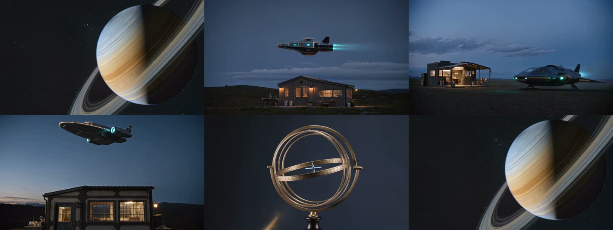
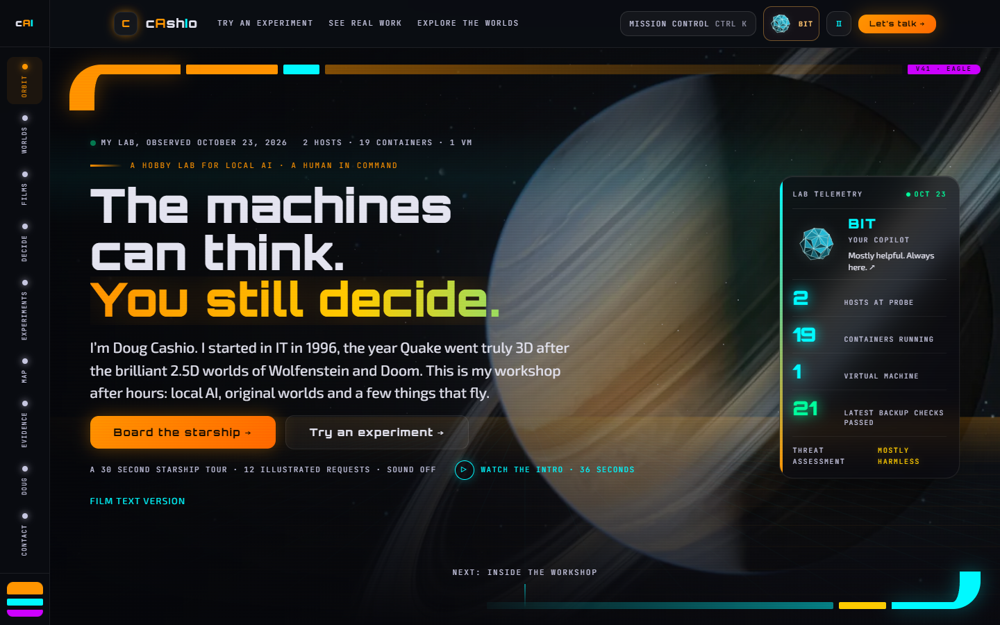
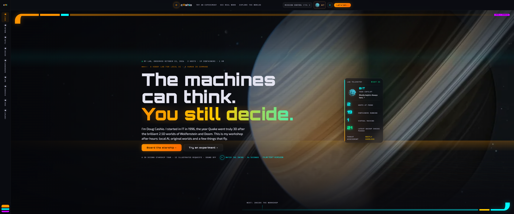
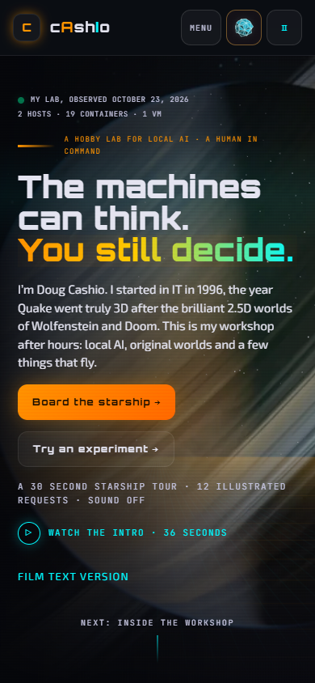

# V41 Eagle review evidence

🟢 Eagle is prepared on `preview/v41-hero-integration` from `2c0ffe613a14f9f9ebacf3255b7ff4d0234cf488`. The arrival and headline now share one composition. Doug owns the merge and Cloudflare purge.

## Transfer measurements

Cold Chrome 155, empty browser contexts, cache disabled, local preview transport with compressed text. The first view is sampled two seconds after load, before the new arrival streams. Scroll advances by 80 percent of viewport height every 180 ms, then settles for 1.5 seconds. Values include response overhead. The baseline was built from the original commit and measured with the same procedure. This describes this controlled pass, not every visitor or scroll speed.

| Viewport  | Before first view without video | After first view without video | Before first view total | After first view total | Before full scroll | After full scroll |
| --------- | ------------------------------: | -----------------------------: | ----------------------: | ---------------------: | -----------------: | ----------------: |
| 1440×900  |                       1,002,027 |                        583,742 |              10,157,116 |                583,742 |         17,330,034 |         7,311,463 |
| 3440×1440 |                       1,002,027 |                        583,742 |              10,157,116 |                583,742 |         17,330,034 |         5,095,340 |
| 390×844   |                       1,002,027 |                        583,742 |               7,994,428 |                583,742 |         13,128,907 |         6,683,760 |

First view passes the 3 MB desktop and 1.5 MB phone budgets. The headline and both main actions fit at all three sizes in the runtime check at 1.5 seconds after load. Four video requests occur during each measured scroll, with one player owning playback at a time. All passes have zero page errors and no horizontal overflow. [Measurements](v41/measurements.json) include bounds and individual video transfers.

## Lighthouse on built output

Lighthouse was measured on initial Eagle commit `93ed08f2e0ce62cae9a36924f777525f2598a397`. Final transfer sizes above were measured again after the archive citation and release title fixes. The V41 composition and all media files are unchanged.

Lighthouse 13.5, Chrome 155. Three cold lab runs per viewport. Desktop uses a 40 ms simulated round trip, 10 Mbps and CPU multiplier 1. Phone uses Lighthouse mobile simulated throttling with CPU multiplier 4. The hero fit check uses normal local conditions; a throttled mobile connection can take longer than two seconds to paint.

| Width | Performance runs | Median | Median LCP | Median blocking time | Accessibility | Best practices |
| ----- | ---------------- | -----: | ---------: | -------------------: | ------------: | -------------: |
| 1440  | 100, 100, 100    |    100 |     0.62 s |                 0 ms |           100 |            100 |
| 3440  | 100, 100, 100    |    100 |     0.63 s |               4.5 ms |           100 |            100 |
| 390   | 89, 87, 89       |     89 |     3.14 s |             152.5 ms |           100 |            100 |

SEO is 69 because this local preview intentionally sends `X-Robots-Tag: noindex, nofollow, noarchive`. The document retains production index and canonical metadata. No production SEO result is claimed. Raw JSON and HTML reports are retained with the local review outputs.

## Accessibility and interactions

`tests/v41-runtime.test.mjs` checks 1440×900, 3440×1440 and 390×844 with axe WCAG A and AA, best practices and the additional visible label rule. Each has zero serious or critical violations. Checks cover descriptive thumbnails, heading spaces, silent startup, reduced motion, data saving, replay, captions, Escape, focus return, direct intro bookmarks, the fixed header visibility boundary and dialog suspension.

The V40 suite covers 320, 390 and 1440 layouts, 44 pixel phone buttons, keyboard access, Bit, E.V.E., Mission Control, seven experiments, four interactive worlds, reading editions and preserved routes. Both AV1 and forced H.264 replay are exercised. All twelve renditions completed a full FFmpeg decode without errors.

## Media receipts

Each rendition is 36 seconds and 16:9. AV1 comes first, then H.264. Desktop selects 1080p, phone 720p, and data saving or slow connections select 480p for an explicit replay. Arrival has no audio stream. Replay has three existing site effects separated by silence and opens muted. Sources are existing site films; their original resolution limits detail in the 1080p export.

| Size  | Silent AV1 bytes | Replay AV1 bytes | Silent H.264 bytes | Replay H.264 bytes |
| ----- | ---------------: | ---------------: | -----------------: | -----------------: |
| 1080p |        1,730,335 |        1,777,342 |          3,226,903 |          3,274,766 |
| 720p  |        1,054,071 |        1,101,078 |          1,363,089 |          1,410,984 |
| 480p  |          635,349 |          682,372 |            684,187 |            732,098 |

[Manifest and checksums](../public/assets/hero/cashio-v41-eagle-manifest.json) · [1080p AV1 arrival](../public/assets/hero/cashio-v41-eagle-arrival-1080p-av1.mp4) · [720p H.264 replay](../public/assets/hero/cashio-v41-eagle-replay-720p-h264.mp4) · [Captions](../public/assets/hero/cashio-v41-eagle-text.vtt)



## Freshness

The October 23, 2026 observation reports 19 running containers of 20 documented, one running virtual machine of two, and two hosts reporting running guests. The backup API listed 124 snapshots and reported successful verification of the latest snapshot for each of 21 guests. Inventory does not establish application health. Backup integrity does not prove a restore, complete coverage or offsite recovery.

A read only refresh request was left for Omnius. No new scheduler export had returned when this preview was prepared. Scheduler, quorum, routing and model configuration figures remain null with explicit reasons. Public capability lanes and the private catalog stay separate. `status.json` and both current public aliases are identical. Historical observations and clocks retain their original dates. The archive prerender no longer overwrites the current evidence alias.

## Code and visual changes

The page file fell from 351,100 to 88,226 bytes. Eleven section components own the hero, workshop, worlds, films, routing, decisions, experiments, machines, evidence, operator and contact. The inline style helper is gone. Static rules and finite interaction variants use external CSS. Lint includes extracted sections. Assets have descriptive names with original hashes retained, and thumbnails ship at 320, 640 and 1280 widths.

The native pointer, strict CSP, three original typefaces, planet, LCARS rail and palette remain. The routing law has a compact transition. Reading mode works without JavaScript. Two redundant startup renders were removed. Secondary CSS and the arrival dissolve remain deferred.

## Nine category scorecard

Engineering self assessment against the task order. Doug retains final visual judgment. Performance considers transfer budgets, encode limits and lab results together; Lighthouse numbers remain visible above.

| Category         | Score | Evidence                                                                                       |
| ---------------- | ----: | ---------------------------------------------------------------------------------------------- |
| Brand            |   9.5 | Original type, colors, planet, rail, Bit and E.V.E. preserved.                                 |
| Content clarity  |   9.3 | One intro, exact hero lines, heading spaces, dated observations and withheld figures.          |
| UX flow          |   9.2 | First screen actions, skip, once per session arrival, replay, Escape and focus return.         |
| Responsiveness   |   9.2 | Three required hero sizes, 320 pixel coverage, wide stage and coarse pointer targets.          |
| Performance      |   9.0 | Transfer and rendition budgets, fewer video requests, AV1, responsive thumbnails and lab runs. |
| Accessibility    |   9.2 | Zero serious or critical axe findings, captions, text, motion and keyboard checks.             |
| Code cleanliness |   9.0 | Eleven sections, external styles, descriptive assets, recursive lint and aligned evidence.     |
| Interactivity    |   9.2 | Existing copilot, console, experiments and route checks plus new playback tests.               |
| Wow              |   9.4 | Full bleed film and headline share the planet composition and continuous dissolve.             |

## Screenshots

### 1440×900



### 3440×1440



### 390×844



## Reproduce

```sh
npm ci
npm run verify
node scripts/serve-helios-preview.mjs dist 4191
```

In a second terminal:

```sh
node scripts/measure-v41.mjs after
node scripts/lighthouse-v41.mjs 3
```

Results go under ignored `artifacts/v41/`. `CHROME_PATH` selects an installed browser for Lighthouse; `V41_URL` changes its target. The transfer script accepts its URL as the second argument. Rebuild the film with `python scripts/build-v41-media.py`, then review the updated manifest.

## Risks and review points

🟡 Chromium lab results do not cover physical iOS, Safari, Firefox, spoken screen reader output or field network conditions. Phone timing and remaining image delivery advice are preserved in the reports. Both codecs were decoded and played in Chrome. Historical pages retain dated evidence; no scheduler response, new routing proof or restore rehearsal is implied.

Open review points for Doug: Does the arrival pacing feel right on the actual ultrawide display at 90 percent zoom? Are the sparse replay effects at the preferred level when sound is explicitly enabled?

T1: Review the three hero compositions and full arrival.

T2: Check cinema sound and a physical phone if available.

T3: Merge the reviewed PR when satisfied, then perform the owner managed Cloudflare purge.

T4: Confirm the deployed V41 receipt, evidence alias and first visit behavior. Rollback is a reviewed revert of the V41 squash commit or redeployment of the baseline.
